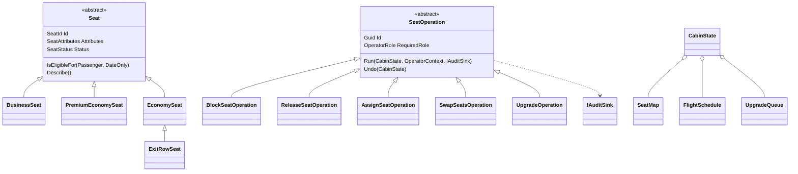

# SeatOps SX 0350

Internes, konsolenbasiertes Sitzmanagement für den fiktiven Flug SX 0350 (MUC–SIN). Die Implementierung ist eine C#/.NET-10-Projektbasis mit Domänenkern, CLI, CSV-Grundfunktionen, SHA-384-Auditkette und xUnit-Tests.

## Voraussetzungen

- .NET SDK 10.0.100 oder neuerer Feature-Band-SDK 10
- ICU-/Globalization-Unterstützung (Invariant Globalization bleibt ausgeschaltet)
- Netzwerkzugriff beim ersten Restore, damit libraries bezogen werden können; Produktionsprojekte enthalten keine Paketabhängigkeiten

## Build und Start

```sh
dotnet restore SxSeatOps.sln
dotnet build SxSeatOps.sln --no-restore
dotnet run --project src/SxSeatOps.Cli
```

Manuelle Uhr und Skriptmodus:

```sh
dotnet run --project src/SxSeatOps.Cli -- --manual-clock 2026-12-18T08:00:00+01:00

dotnet run --project src/SxSeatOps.Cli -- --manual-clock 2026-12-18T08:00:00+01:00 --script scenarios/dispatch.seatops
```

Die interaktive Konsole nutzt `SeatOps>`. Beenden mit `EXIT` oder EOF. `CLOCK` ist nur bei `--manual-clock` wirksam. Die derzeit umgesetzten Konsolenbefehle und ihre Grenzen sind in `docs/REFLEXION.md` aufgeführt.

## Tests

```sh
dotnet test tests/SxSeatOps.Tests
```

Die Unit-Tests verwenden xUnit, FluentAssertions und FakeItEasy. Integrationsabläufe sind als Reqnroll-Feature-Szenarien formuliert und laufen ebenfalls mit xUnit. Theories enthalten zusätzliche Fallwerte; die Anzahl der Testfälle kann daher von der Zahl der Testmethoden und Szenarien abweichen. Dies ist keine gemessene Code-Coverage.

## Fehlerkonzept

Ungültige Benutzereingaben und erwartbare Geschäftsregelverletzungen werden über Try-Methoden oder `OperationResult` gemeldet. Exceptions bleiben Programmierfehlern (z. B. null-Argumente), ungültigen Konstruktorwerten und nicht behebbaren Datei-/E/A-Fehlern vorbehalten. Importdatenfehler werden als `ImportIssue` erfasst und übersprungen. Der Import prüft die Dateigröße vor dem Parsen.

## Implementierte Kernbausteine

- Verbindliche Domänen-Enums, `SeatId`, Passagier-, Sitz- und Kabinenmodelle
- Kabinenlayout mit algorithmisch abgeleiteten Attributen; 289 Plätze
- Zeitzonenmodell, Check-in-/Freeze-Grenzen, Altersregeln und manuelle Uhr
- Parser für Namen, Zahlen, Zeitstempel, PNR/Ticketnummern und Befehlsgrundformen
- Zuordnung, Sperre/Freigabe, Tausch, Upgrade, Statuskonsistenz, Schnappschuss und Undo/Redo-Grundlagen
- Priorisierte Upgrade-Warteschlange und Gebührenrundung
- SHA-384-Auditkette mit kanonischer Serialisierung und Verifikation
- CSV-Zustandsautomat, Import-Basis, deterministische Exporte und atomisches Schreiben
- Binärsuche, Grenzen, stabile Sortierung sowie Sitzgruppensuche

## Bewusst nicht als erledigt ausgewiesen

1. Die PDF-Aufgabe ist erheblich größer als ein vertikaler Sitzplan-Prototyp. Nicht alle Pflichtvarianten jedes Moduls (z. B. sämtliche Überladungen/Compilerexperimente, alle CLI-Befehle, komplette F5-/I3-Workflows) sind umgesetzt.
2. Die Tests wurden hier nicht kompiliert oder ausgeführt. Vor Einsatz/Abgabe muss ein SDK-10-Lauf erfolgen und gefundene Compiler-/Testfehler müssen behoben werden.
3. Plattformbeobachtungen, Testcoverage-Prozente, Sortiervergleichszahlen und Proof-of-Work-Zeiten müssen in der Zielumgebung gemessen und ergänzt werden; sie hängen von Laufzeit, ICU und Hardware ab.
4. Der Manifestimport verarbeitet die eingelesenen Records im Speicher. Eine vollständig streaming-basierte 5-MB-Verarbeitung und alle Anhang-A-Erwartungen sind noch zu verifizieren.

## Architektur



## Komplexität (Kernalgorithmen)

| Vorgang | Laufzeit | Zusatzspeicher |
|---|---:|---:|
| Sitzsuche nach Kabine | $$O(n)$$ | $$O(1)$$ |
| Gruppensuche | $$O(n \cdot s)$$, wobei $$s$$ die Gruppengröße ist | $$O(s)$$ |
| Eigene Binärsuche / LowerBound / UpperBound | $$O(\log n)$$ | $$O(1)$$ |
| Merge Sort | $$O(n \log n)$$ | $$O(n)$$ |
| Dictionary-Zugriff (erwartet) | $$O(1)$$ | $$O(1)$$ |
| CSV-Tokenisierung | $$O(L)$$ für gelesene Zeichen | $$O(L)$$ im aktuellen In-Memory-Import |

## Messwerte

- Proof of Work: Erwartungswert für Zufallshashes $$16^d$$ Versuche bei $$d$$ führenden Hex-Nullen. Tatsächliche 20-Block-Messungen für $$d=1..4$$ sind **noch nicht erhoben**.
- Merge-Sort-Vergleichszahlen für $$n=10,100,1{,}000,10{,}000$$ sind **noch nicht erhoben**.
- Messwerte werden erst nach Ausführung auf einer benannten SDK-/Hardware-/ICU-Konfiguration eingetragen.

## Anhang-A-Manifest: erwartete Importentscheidung

| Datensatz | Erwartung | Grund |
|---|---|---|
| K7M4QZ | akzeptiert | gültige erste PNR-Zeile; Name transliteriert, Check-in im Fenster |
| R2D9TX | akzeptiert | gültige Business-Vorbelegung 2K |
| B5N8WH | akzeptiert, ohne Sitz | Kleinkind; Sitzfeld leer |
| W6S3NY | akzeptiert | gültige Premium-Economy-Zeile |
| doppelte K7M4QZ | übersprungen | erste PNR-Zeile gewinnt |
| H3P6VD | übersprungen | ungültiges Datum 31.02.1992 |
| T8C2FJ | übersprungen | Meilen nicht numerisch |
| Q0X7LM | übersprungen | PNR enthält unzulässige Ziffer 0 |
| verkürzte Z9Y8XW-Zeile | übersprungen | erforderliche Pflichtfelder fehlen |

Diese Tabelle dokumentiert den vorgesehenen Importvertrag; sie ersetzt keinen Testlauf mit dem vollständigen Originalanhang.
